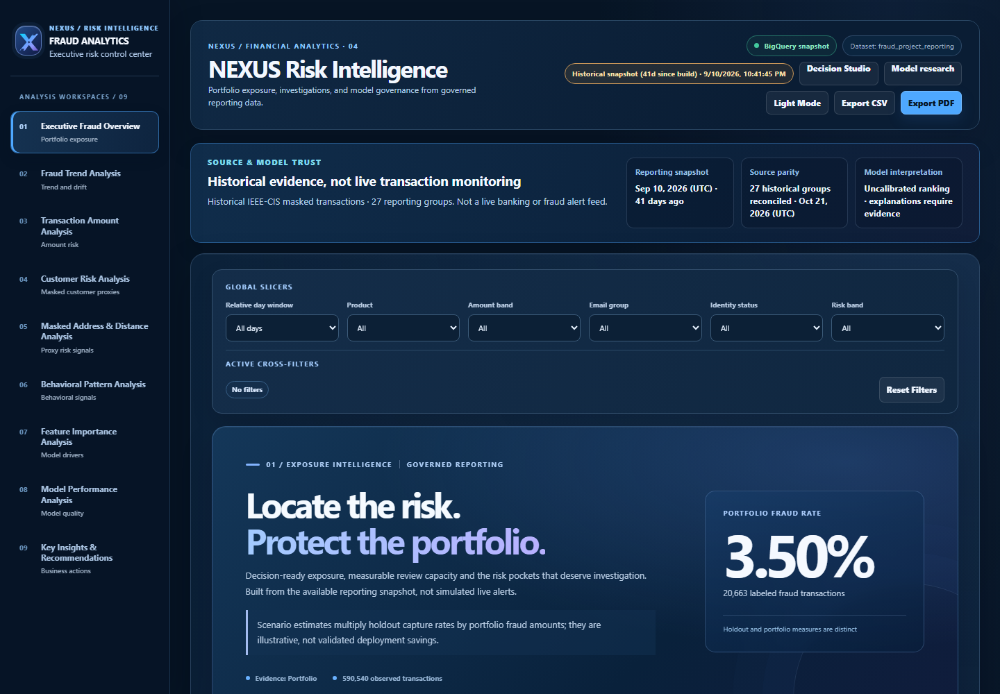
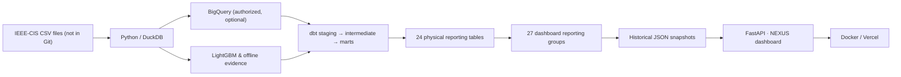

<p align="center">
  
</p>

# IEEE-CIS Fraud Risk Intelligence

**An evidence-first, historical fraud analytics project** combining data engineering, time-aware machine-learning evaluation and an interactive NEXUS dashboard. Built on the [IEEE-CIS Fraud Detection dataset](https://www.kaggle.com/c/ieee-fraud-detection); no competition data is redistributed here.

[](https://github.com/senanurcetin/ieee-fraud-detection-analytics/actions/workflows/ci.yml)
[](https://github.com/senanurcetin/ieee-fraud-detection-analytics/actions/workflows/container-smoke.yml)
[](LICENSE)

[**Explore the published dashboard**](https://fraud-project-web.vercel.app) · [**Read the documentation**](docs/README.md) · [**Kaggle notebooks**](notebooks/README.md) · [**View release evidence and blockers**](docs/RELEASE_STATUS.md)

**Project status (22 October 2026): Active noncommercial research portfolio; historical validation completed.**
The [completed validation report](docs/research/COMPLETED_VALIDATION_2026-10-21.md) records all 27 BigQuery public groups reconciled and a full-source, three-window LightGBM500 calibration study. [Explore the separate model research page](https://fraud-project-web.vercel.app/research). The historical dashboard model remains explicitly uncalibrated; new calibrated probabilities belong to a separate version. Playwright remains disabled. See [release evidence and scope](docs/RELEASE_STATUS.md).



*Real browser capture on 22 October 2026; [native Chromium capture provenance](docs/assets/native_browser_provenance_20261022.json). The view serves the 10 September historical snapshot. Capture source/revision and normalized source hashes are retained; it is not a live transaction feed.*

## What this project demonstrates

- **Analytics engineering:** DuckDB preparation; BigQuery raw, staging, intermediate, mart and reporting datasets; 38 dbt models with reconciliation and governance tests.
- **Risk modeling:** LightGBM ranking, chronological holdout, class-imbalance-aware evaluation and cost/capacity-sensitive threshold analysis.
- **Product analytics:** Nine BI-style pages, filter-linked visuals, masked-proxy drill-through, explainability summaries and a read-only historical analyst review.
- **Delivery engineering:** FastAPI, containerized offline demo, Vercel, Python CI, real-browser acceptance and separately gated public release attestation.

## Historical dataset and evaluation

| Historical evidence | Value |
|---|---:|
| Train transactions | 590,540 |
| Fraud-labeled train transactions | 20,663 |
| Baseline fraud rate | 3.50% |
| Chronological validation ROC-AUC | 0.9134 |
| Chronological validation average precision | 0.5354 |
| Top 5% score band: precision / fraud recall | 40.13% / 58.32% |

The reported evaluation is based on a **time-ordered holdout**, not random validation. [Methodology and limitations](docs/ieee_cis_dataset_methodology.md) · [Model validation evidence](docs/model_validation_evidence.md) · [Modeling decisions](docs/modeling_decisions.md).

**Important boundaries:** IEEE-CIS has masked transaction and identity features; `TransactionDT` is relative elapsed time, not a real calendar timestamp. The current `predicted_fraud_probability` field is an **uncalibrated ranking score**, not a verified customer-specific fraud probability. Global feature-importance summaries are distinct from locally generated TreeSHAP evidence. No real-time payment monitoring, card blocking, customer identification or fully validated production model is provided.

## Architecture



The **public dashboard reads committed historical JSON snapshots** by default; it does not query BigQuery to serve every request. The latest committed snapshot was built **10 September 2026**. All 27 public report groups were reconciled against authorized source reads on 21 October, including explicit floating-aggregation tolerance for one group. This dated audit does not refresh the snapshot or establish a live feed. See [architecture](docs/architecture.md), [lineage](docs/bigquery_dbt_lineage.md) and [source evidence](docs/BIGQUERY_SOURCE_VERIFICATION_2026-10-15.md).

## Quick start — no cloud account required

From the repository root, with Python 3.11 and Docker Compose:

```bash
docker compose build
docker compose up -d
python -m scripts.verify_snapshot_release --base-url http://127.0.0.1:8000
# Open http://127.0.0.1:8000/
docker compose down
```

This demo loads **historical snapshots only**. A `PASS_HISTORICAL_OFFLINE_DEMO` confirms local presentation contract integrity, **not** freshness, BigQuery reconciliation or model recalibration. [Docker runbook](docs/F08_LOCAL_RELEASE.md).

Alternatively, start the web server in a local Python 3.11 environment:

```bash
python -m venv .venv
# Activate .venv for your shell
python -m pip install -r webapp/requirements.txt
python -m uvicorn webapp.main:app --host 127.0.0.1 --port 8000
```

## Reproduce the analytical pipeline (data access required)

The raw IEEE-CIS files are **not** tracked. Obtain them through Kaggle under the competition's terms and place them under `data/raw/kaggle_ieee_fraud/`. After installing `requirements.txt` and `requirements-dev.txt`:

```bash
python src/prepare_raw_and_ml.py
dbt deps --project-dir .
dbt build --project-dir . --profiles-dir config/dbt --profile ieee_fraud_detection --target dev
```

The local `dev` profile uses DuckDB. BigQuery production models, table uploads and billed queries require **separate authorized credentials, budget checks and release approval**. They are not part of routine CI. [Environment setup](docs/environment_setup.md) · [BigQuery source audit](docs/BIGQUERY_BOUNDED_SOURCE_PARITY.md).

## Validation and delivery

```bash
python -m pip install -r requirements.txt -r requirements-dev.txt
ruff check .
pytest
python -m compileall webapp
dbt deps --project-dir .
dbt parse --project-dir . --profiles-dir config/dbt --profile ieee_fraud_detection --target dev
```

A native Chromium CDP tool covers desktop/mobile dashboard, Studio and research rendering, nine-page navigation, themes and Studio tabs. The earlier Playwright workflow stays disabled. GitHub Actions covers the Docker/HTTP snapshot smoke test. The **public-production** test checks the exact deployed SHA and HTTPS responses and must not be confused with local test success.

| Release gate | Scope |
|---|---|
| [CI](.github/workflows/ci.yml) | Python, Ruff, Pytest, dependency auditing, dbt parse; data build only with authorized credentials |
| [Native browser acceptance](scripts/capture_browser_evidence_cdp.py) | Real Chromium desktop/mobile; optional local capture, no Playwright |
| [Container smoke](.github/workflows/container-smoke.yml) | Docker Compose boot and historical HTTP contract |
| [Public release attestation](.github/workflows/public-release-smoke.yml) | Exact Vercel commit SHA, source disclosure and public HTTPS routes |

Historical [source reconciliation](webapp/research/source-parity.json) and [versioned calibration evidence](webapp/research/published-model-calibration.json) are complete for the recorded runs. Prospective customer validation, live payment decisions and untested browser engines are outside the current noncommercial release scope. Green code checks do not imply those capabilities.

## Project map

```text
config/dbt/        dbt connection profiles (no secrets)
models/            staging → intermediate → marts → reporting SQL
src/               ingestion, modeling, SHAP and drift utilities
scripts/           reproducible audits, benchmarks and local release checks
webapp/            FastAPI, static dashboard and historical JSON snapshots
tests/             Python, browser and dbt reconciliation tests
docs/              technical reference, methodology and dated evidence
infra/bigquery/    optional Terraform dataset definitions
notebooks/         controlled analytical research notebook
```

**Documentation starts at [docs/README.md](docs/README.md).** [Development scope and roadmap](docs/DEVELOPMENT_PLAN.md). Contribution workflow: [CONTRIBUTING.md](CONTRIBUTING.md). Security reporting and credential policy: [SECURITY.md](SECURITY.md).

## License

Source code is released under the [MIT License](LICENSE). The IEEE-CIS dataset is subject to its original competition terms and is not included in this repository.
