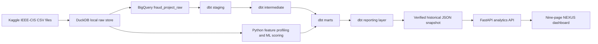

# Architecture

This project is structured as an analytics engineering pipeline, not as a notebook-only analysis. The goal is to move from raw competition data to tested analytical marts, model-driven risk scores, and an executive reporting layer.

## End-to-End Flow



## BigQuery Datasets

| Dataset | Purpose |
|---|---|
| `fraud_project_raw` | Raw Kaggle tables and model support outputs |
| `fraud_project_staging` | Typed and normalized source views |
| `fraud_project_intermediate` | Joined transaction and identity records with engineered features |
| `fraud_project_mart` | Reconciled fraud, segment, risk-band, time, amount, and quality marts |
| `fraud_project_reporting` | Historical reporting tables used to generate a versioned web dashboard snapshot |

## dbt Model Layers

| Layer | Main models | Responsibility |
|---|---|---|
| Staging | `stg_transactions`, `stg_identity` | Type casting, safe naming, TransactionDT-derived fields, amount-cent features |
| Intermediate | `int_fraud_joined`, `int_features` | Transaction and identity join, product/payment/email/device segmentation |
| Marts | `mart_*` | Fraud summary, risk bands, amount bands, daily drift, payment/email risk, quality checks |
| Reporting | `fact_train_transactions`, `rpt_*` | Executive KPIs, web visual tables, segment watchlists, model performance, quality contracts |

## Reporting Design

The published dashboard normally serves **committed historical JSON snapshots** through FastAPI. The snapshots are derived from the `fraud_project_reporting` layer but are not live BigQuery query results. Internal source refresh or independent data verification is a separate authenticated workflow. Raw Kaggle tables and staging models are intentionally excluded from the public presentation surface. Source freshness and model-scoring limitations are disclosed in the UI and [release status](RELEASE_STATUS.md).

Snapshot loading checks the aggregate group structure and reloads replaced artifacts. Missing, corrupt or deleted files fail closed for public requests, including a file disappearing after an initial availability check; the authorized internal token is required before any warehouse fallback. Structural validation does not certify source parity or metric truth. `/api/health` remains network-free even with a configured cloud project; dataset reachability is handled by authorized diagnostics.

The restricted research importer (`scripts/prepare_research_duckdb.py`) replaces both train tables in one DuckDB transaction. Required row counts, unique non-null transaction/identity keys, identity referential integrity, binary labels and finite nonnegative relative times must pass before commit. Any failed validation preserves previously valid research tables. This validates input integrity, not independent Kaggle authenticity.

Private TreeSHAP evidence uses SQLite artifacts with explicit connection closure on reads, successful writes and exceptions. Writers commit and close before atomic replacement, so artifact rotation also works on Windows. The web reader remains standard-library-only and read-only; no explanation artifact is generated or published by serving the dashboard.

## Quality Gates

- Source row-count tests verify Kaggle table completeness.
- Staging tests validate key fields, ranges, and transaction uniqueness.
- Reconciliation tests check fact and mart consistency.
- Risk-band tests enforce expected risk labels and monotonic behavior.
- Report-readiness tests verify that the web reporting layer is complete.

Historical BigQuery/dbt build verification (not an assertion about the current source or latest deployment):

```text
dbt build: PASS=164 WARN=0 ERROR=0 SKIP=0 NO-OP=1 TOTAL=165
Scope: 38 models, 126 data tests, 10 sources, 1 exposure
```
