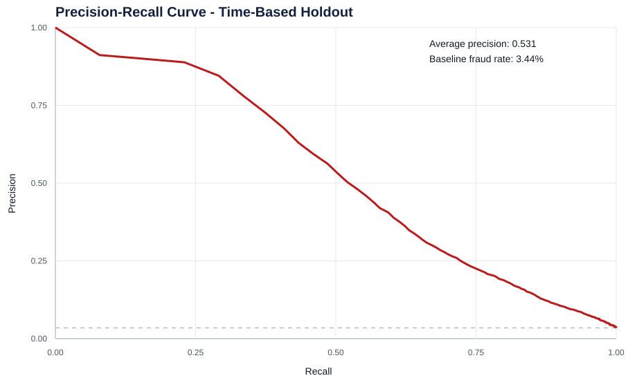

# Published historical model: validation and limitations

This is the maintained model summary, consolidating the former `model_results.md`. Metrics belong to the **historical 500-estimator LightGBM ranker**, not the later 100/150-estimator research experiments. They are retained evidence, not a new training run or certification of current BigQuery parity.

## Source and population

- Registry: [model_registry.json](model_registry.json), version `lightgbm-v2-v339-missingness-filtered`, 425 selected predictors.
- Reporting snapshot: [dashboard.json](../webapp/snapshots/dashboard.json), built 10 September 2026.
- Chronological holdout: final 20% of `TransactionDT`; 118,108 rows, 4,064 fraud labels. `TransactionDT` is relative elapsed time, not a calendar timestamp.
- Supporting aggregate tables: [recomputed validation](model_validation_recomputed.md). Recreating that report requires the private validation artifacts; it does not retrain or independently validate the model.

## Recorded holdout metrics

| Metric | Historical value |
|---|---:|
| ROC-AUC | 0.9134 |
| Average precision | 0.5354 |
| Fraud prevalence | 3.44% |
| Top 5% score band precision | 40.13% |
| Top 5% score band fraud recall | 58.32% |
| Top 5% score band workload | 5.00% |
| Top 5% score band false-positive rate | 3.10% |
| Score threshold for that band | 0.6767 |
| Fixed score threshold 0.50 precision / recall | 25.68% / 69.78% |
| Brier score / constant-prevalence baseline | 0.0636 / 0.0332 |
| Expected calibration error | 0.1452 |

Average precision is reported as its own metric, not as an interchangeable trapezoidal PR-AUC. The 0.50 setting is a **ranking-score threshold**, not a calibrated probability cutoff. The top 5% band is retrospective capacity evidence; selecting a policy requires separate data and actual review costs.

## Validation scope

The published pipeline and registry include three expanding-window evaluations in addition to the final holdout, with a recorded mean ROC-AUC of approximately 0.9100. This supersedes the old statement that rolling evaluation had not been implemented. These historical evaluations do not establish that every preprocessing decision was fitted independently within each fold. See [modeling decisions](modeling_decisions.md).

The separate [canonical full-source research](research/KAGGLE_CANONICAL_STABLE_RESEARCH_2026-10-17.md) measures fold-fit temporal hygiene, native categorical handling, and disjoint 60/20/20 Platt/isotonic calibration. Those experiments use different estimator counts and feature/preprocessing contracts. Their results must not be substituted into the published registry or dashboard.

## Explainability and safe interpretation

Feature-importance summaries are global model diagnostics. `/api/enterprise/cases/{transaction_id}/explain` is explicitly a global-importance heuristic, **not local TreeSHAP**. Verified local TreeSHAP has a separate private artifact and authorized endpoint; see [local explanations](LOCAL_SHAP_EXPLANATIONS.md).

The public score is **uncalibrated**. Masked variables do not identify real customers, geography, causal fraud mechanisms or prevented monetary losses. Hypothetical review-cost scenarios are not measured business savings.

Before publishing a calibrated replacement, match the exact base model and feature scope, reserve independent later evaluation data, check calibration by time/segment, and version the output contract. Current source and release gates are tracked in [release status](RELEASE_STATUS.md).
