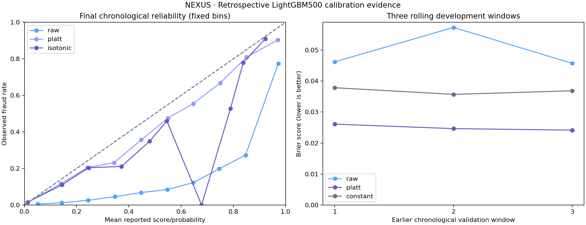

# Completed historical validation — 21 October 2026

Release documentation prepared on 22 October. Measurements below belong to their actual 21 October executions; the September reporting snapshot was not refreshed.

## BigQuery: all 27 public reporting groups

[Retained source audit](../../webapp/research/source-parity.json) reconciles `workintech-working.fraud_project_reporting` in `US`. The verifier reads 24 source tables through read-only metadata and `tabledata.list`, with 590,540 selected fact rows and a maximum of 10,000 rows per report table. Raw records stay in memory. It executes the exact application SQL locally in DuckDB, then applies `normalize_public_row`. Cloud SQL jobs, cloud writes and raw-record exports are all zero.

Twenty-six groups match the existing six-decimal comparator. In `niche_drilldown`, two average cells straddle a decimal-rounding boundary. The original strict `DIFF` remains recorded. A separate numeric-equivalence diagnostic checks every field with absolute tolerance `1e-9` and relative tolerance `1e-12`; integer counts, keys, text and nulls remain strict. The group's largest floating residual is `2.1187588572502136e-08`. This is explicitly reported as `MATCH_WITH_FLOAT_AGGREGATION_TOLERANCE`, not literal byte equality. All 27 public contracts reconcile under the disclosed policy.

Before/after metadata signatures guard against source mutation and incomplete pagination. Evidence includes query hashes, selected-row fingerprints, source modification metadata and the audited snapshot's canonical SHA-256. The public evidence loader rejects a different snapshot or changed reporting query. This is a dated reconciliation, not a live-feed or source-lineage rebuild claim. Keyless GitHub WIF remains an optional automation configuration; successful local authorization does not imply it is configured.

```bash
python -m scripts.verify_reporting_full_parity_readonly \
  --credentials-file /private/credentials/workintech.json \
  --allow-bounded-fact-read --output outputs/qa/full_parity.json
```

Use `--use-adc` instead of the private credential-file argument for an authorized keyless environment. The older direct-table verifier retains its smaller scope and strict verdicts.

## Versioned LightGBM500 calibration and temporal robustness

[Public executed notebook](https://www.kaggle.com/code/senanuretin/ieee-cis-lightgbm500-temporal-calibration): kernel `140019647`, version 2, provider `COMPLETE`, CPU only, notebook internet disabled, official competition source. The first submission failed because it assumed a fixed mount path; version 2 discovers exactly one training-file pair and verifies the known transaction-file digest. Downloaded notebook cells match the repository, and the result's implementation digest matches the reviewed script.

[Canonical aggregate evidence](../../webapp/research/published-model-calibration.json) identifies `lightgbm-v3-temporal-calibrated-20261021`. It uses the historical 500-tree parameter and candidate-feature families, with vocabularies and V-feature missingness fitted on each core window. It is a new fit with 425 final predictors, not the historical v2 model weights.

Three earlier rolling validation windows select the calibration method using mean Brier score. **Platt** was selected before final evaluation. The final split is core **354,324**, calibration **118,108**, evaluation **118,108** rows. Timestamp groups remain intact, with strictly separated periods. Final evaluation has **4,064** fraud labels. No selection or fitting uses those final labels; the entire dataset has nevertheless been explored in earlier research.

| Final method | ROC-AUC | Average precision | Brier score | Log loss | ECE |
|---|---:|---:|---:|---:|---:|
| Raw new-model ranking score | 0.877481 | 0.483626 | 0.063165 | 0.234619 | 0.144761 |
| Platt, selected in development | 0.877481 | 0.483626 | 0.023268 | 0.098530 | 0.004788 |
| Isotonic, descriptive comparison | 0.876854 | 0.469723 | 0.023479 | 0.099092 | 0.006582 |
| Earlier calibration-period prevalence | 0.500000 | 0.034409 | 0.033247 | 0.150047 | 0.004631 |

Platt improves its base model's probability errors while preserving ranking; this does **not** claim better discrimination than historical v2's different fit. The constant baseline has low ECE but cannot rank cases. All four declared retrospective acceptance conditions pass: Brier better than raw and constant, log loss better than constant, and ROC-AUC loss no more than 0.01.

The paired relative-day bootstrap uses 42 blocks, 1,000 resamples and seed 42. Selected-minus-constant Brier difference is `-0.009978`, with approximate 95% percentile interval `[-0.011634, -0.008512]`, conditional on the fixed fitted model. It excludes model-fit uncertainty and may retain inter-day dependence. Four final time quartiles, fixed reliability bins and all development-window metrics are retained in the aggregate artifact.

At the top 5% review capacity: 5,906 records, 2,139 fraud labels, precision **36.22%**, recall **52.63%**; approximate Wilson precision interval **35.00–37.45%**. Queue membership is score/order based, not label selected. These are retrospective workload observations, not prevented-loss estimates.



The public `/research` page and `/api/research/calibration` expose the new version's aggregate evidence and separate `risk_score` / `calibrated_fraud_probability` definitions. Its mapping must never be applied to historical v2 dashboard scores. No transaction-scoring API or automatic payment decisions are introduced. Raw records, fitted model binaries and credentials are not redistributed.

## Reproduce the science

Attach the official competition source and run [the standalone notebook](../../notebooks/published_model_calibration/published_model_calibration.ipynb), or run locally after authorized download:

```bash
python -m scripts.benchmark_published_model_calibration \
  --transaction data/raw/kaggle_ieee_fraud/train_transaction.csv \
  --identity data/raw/kaggle_ieee_fraud/train_identity.csv \
  --output outputs/research/published-model-calibration.json
```

An AST regression verifies embedded notebook/source equivalence. Tests cover timestamp ties, fold-fit vocabularies/missingness, selection windows, queue ties, deterministic uncertainty, and publication rejection of incomplete or altered evidence.

## Operational boundary

This completes bounded historical research and public-report reconciliation. Prospective external customer data, ongoing model monitoring, commercial deployment approval and automatic fraud interventions are outside this noncommercial portfolio project's scope. Historical v2 reports, their uncalibrated score labels and the `2026-09-10T19:41:45Z` source timestamp remain intact.
