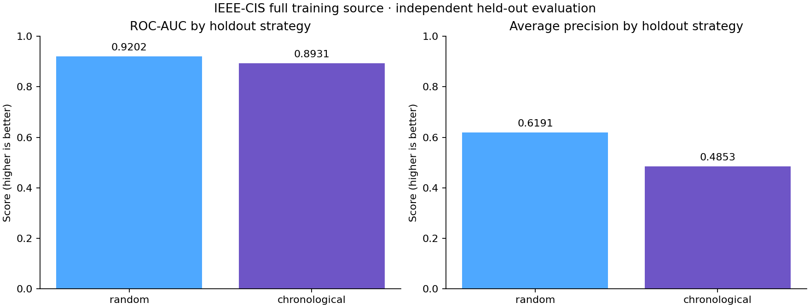
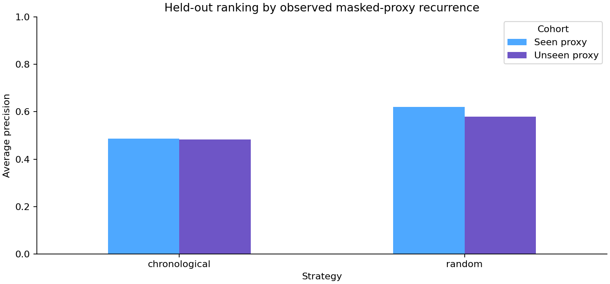

# Kaggle recovery and publication evidence — 20 October 2026

## Current access

The newly supplied credential authenticated as the owner account. The actual IEEE-CIS competition file-list request succeeded, and GitHub repository secret `KAGGLE_API_TOKEN` was updated through stdin without writing the credential to source or logs. Successful local access is distinct from a fresh GitHub runner download; the earlier successful full-data GitHub run remains [39063907895](https://github.com/senanurcetin/ieee-fraud-detection-analytics/actions/runs/39063907895).

## Recovered original notebook

[IEEE-CIS: How Much of Random-CV AUC Is Leakage?](https://www.kaggle.com/code/senanuretin/ieee-cis-how-much-of-random-cv-auc-is-leakage) is now accessible. Authenticated metadata reports `is_private=false`, kernel ID `136455885`, CPU-only execution and the official competition source. The provider status is `COMPLETE`; a separate unauthenticated HTTP request returned 200 with the expected notebook title.

- [Original source, retained unchanged](../../notebooks/archive/original_ieee_cis_leakage.ipynb): SHA-256 `53ad6dec337c1297db8dbcc6ef31f045945360ed3b8319544cc5b47df4a33457`.
- Source export contains 14 cells and no saved outputs. No outputs were fabricated or inserted into the recovered source.
- [Retained provider execution log](evidence/original_execution_log.txt), SHA-256: `4f58ba866448bf9018a33fa86afd1e4c0f294c68fac02c494102ffffcdb79e70`. Only aggregate observations are summarized below; raw competition records are not published in Git.

| Observation in the previously completed provider log | Recorded value |
|---|---:|
| Training rows / merged columns | 590,540 / 434 |
| Model predictors / estimators | 431 / 600 |
| Random-fold ROC-AUCs, folds 0–4 | 0.9708, 0.9713, 0.9696, 0.9729, 0.9706 |
| Chronological holdout ROC-AUC | 0.9205572326070034 |
| Printed random-minus-time ROC-AUC gap | +0.0505 |
| Observed run duration | 8,593 seconds |

These are **recovered prior execution observations**, not a fresh rerun or independent recomputation. The original uses globally coded categorical vocabularies and approximate card/address/time-derived keys. Its customer/causal language is not accepted as verified identity or causal decomposition. The source is retained for provenance, not promoted as the current scientific standard. Missing input-file digests in that original run are not retroactively invented.

## Independent reproducible companion

A separate CPU-only, internet-disabled notebook was submitted as kernel ID `139814704`, version 1: [Random vs Time — Reproducible Study](https://www.kaggle.com/code/senanuretin/ieee-cis-random-vs-time-reproducible-study).

It embeds the reviewed 150-estimator comparison implementation, enforces the full 590,540-row source, records an input SHA-256 and package versions, and renders split/cohort comparisons. It does not overwrite the original 600-estimator notebook or the historical 500-estimator dashboard model.

Provider readback reports **COMPLETE**, with no failure message, and public metadata confirms `is_private=false`. An independent unauthenticated HTTP request returned 200 with the expected title. The aggregate JSON and both figures were downloaded and visually inspected on 20 October. This establishes completed public execution, separately from the earlier GitHub study.

| Full-source companion observation | Random holdout | Chronological holdout |
|---|---:|---:|
| Training / holdout rows | 472,432 / 118,108 | 472,432 / 118,108 |
| ROC-AUC | 0.920220 | 0.893140 |
| Average precision | 0.619111 | 0.485269 |
| Holdout fraud prevalence | 0.034993 | 0.034409 |
| Seen masked-card proxy fraction | 0.965362 | 0.951527 |

The ROC-AUC difference is **0.027080** and average-precision difference is **0.133842**. These are observational differences across distinct splits, not a causal leakage estimate. The chronological training maximum (`12192842`) is strictly below the holdout minimum (`12192900`), including timestamp ties. No confidence interval, production calibration or automatic-decline readiness is established by this single-seed study.

- [Downloaded aggregate metrics](evidence/ieee_cis_split_comparison.json), including all 58 predictors and package versions.
- Training CSV SHA-256: `3a5c83ab6b3cc13dcabe5ffa9f522307fd5f7f7b6e6f6a60c32284ca6283d642`; `subset_mode=false`.
- Runtime versions: Python 3.13.15, NumPy 2.1.3, pandas 2.3.3, LightGBM 4.6.0, scikit-learn 1.6.1.

The current reproducibility deliverable is complete: recovered original source, retained historical provider log, and a separately executed public companion with source hash and downloadable aggregate evidence. BigQuery reconciliation and dashboard-model probability promotion are separate acceptance gates.
